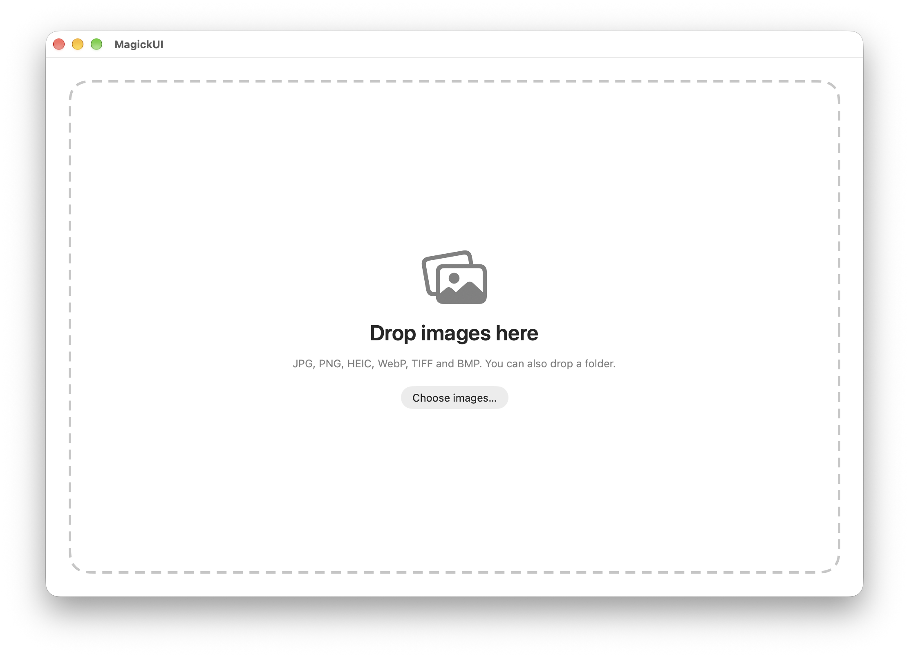

# MagickUI

**A drop-first, offline image app for macOS, powered by ImageMagick.**

Drop your images into the window, then choose what to do: compress to a target size, convert formats, crop, resize, rotate, or strip metadata. Everything runs locally on your Mac and works in batch.




## Why

There are plenty of online image tools (shout-out to my fav [ihateimg.cv](https://ihateimg.cv)), but I wanted one that works offline and in batch. Mac App alternatives exist, but many of them are a \~$20 license which is very pretentious. [ImageMagick](https://imagemagick.org) is free and open source, but it is mainly a command-line tool, so I built a GUI on top of it.

## Features

| Action | What it does |
|---|---|
| **Compress to size** | Gets each image under a size you choose (e.g. 200 KB or 1 MB) at the best quality that fits |
| **Convert format** | Saves images as JPG, PNG, WebP, HEIC, AVIF, TIFF, GIF, BMP, ICO, JP2, JXL, or another image format your ImageMagick can write |
| **Crop** | Drag a crop box on a preview, with aspect-ratio presets, a landscape/portrait swap, and a live preview of the result |
| **Resize** | Set exact pixels or scale by percent |
| **Rotate & flip** | Rotate 90° or 180°, or mirror horizontally or vertically |
| **Remove metadata** | Strips EXIF, GPS, and camera data before you share a photo |

Images only. PDF is intentionally not supported.

## Requirements

- A Mac running macOS 13 or later
- [Homebrew](https://brew.sh)
- ImageMagick 7 (the `magick` command)
- Xcode, to build the app from source

## Install

There is no prebuilt release yet, so you build the app yourself.

**1. Install ImageMagick**

```bash
brew install imagemagick
```

**2. Get the code and open it in Xcode**

```bash
git clone https://github.com/aviedb/MagickUI.git
cd MagickUI
open MagickUI.xcodeproj
```

**3. Check the project settings**

- Under **Signing & Capabilities**, choose **Sign to Run Locally**, or select your own team.
- Keep **App Sandbox** turned off. A sandboxed app cannot run Homebrew's `magick`.
- Set the destination to **My Mac**.

**4. Run or install**

- To try it, press **⌘R**.
- To install it, choose **Product → Archive**. In the Organizer, right-click the archive and choose **Show in Finder**. Then right-click the `.xcarchive` file, choose **Show Package Contents**, open `Products/Applications`, and drag the app into your **Applications** folder.

When you change the code later, repeat the archive step and replace the app.

## How to use

1. **Drop images** (or a whole folder) onto the window, or click **Choose images…**.
2. **Pick an action.** You can switch actions at any time from the tabs at the top.
3. **Adjust the options** (see below).
4. Optionally choose where to save with **Save to → Choose…**. By default, files go next to the originals.
5. Click the **Run** button. Each image in the sidebar shows its result, with a **Reveal in Finder** link.

Use **Show command** to see the exact `magick` command that will run, which is handy for learning ImageMagick.

### Compress to size

Enter a target and a unit, or tap a preset. The app tries high quality first, and if the file is still too big, it shrinks the dimensions only as much as needed and then raises the quality again. PNG is lossless, so it reduces colors first and then dimensions. Images already under the target are left alone. KB means 1,000 bytes, so results also fit sites that count 1,024.

### Convert format

Pick a format chip, or choose **Other…** and type an extension (for example `jp2`). Only formats your ImageMagick can write are offered. Formats without transparency (JPG, BMP) fill transparent areas with white.

### Crop

Select an image in the sidebar, then drag on the preview to draw a crop box. Drag the corners or edges to resize it, and drag inside to move it. Pick an aspect ratio (Free, Original, 1:1, 4:3, 3:2, 16:9, 4:5, or Custom) and use **Swap landscape / portrait** if needed. Each image keeps its own crop. **Apply to all images** copies the crop proportionally to every image, and images without a crop are skipped.

### Resize, Rotate & flip, Remove metadata

Resize accepts pixels or a percentage, and can keep the aspect ratio and avoid enlarging. Rotate & flip applies one operation to every image. Remove metadata strips all embedded data.

## Where files are saved

- Output goes next to each original, or in the folder you choose. Originals are never overwritten.
- Name clashes get a number: `photo 2.jpg`, `photo 3.jpg`.
- Files get a suffix by action: `_compressed`, `_cropped`, `_resized`, `_rotated`, `_clean`. Convert keeps the original name with a new extension (or `_converted` if the format stays the same).

## Supported input formats

JPG, PNG, HEIC/HEIF, WebP, TIFF, and BMP. You can also drop a folder.

## Good to know

- Crop coordinates are applied after the photo is rotated upright (`-auto-orient`), so the crop matches what you see.
- HEIC input is saved as JPG by every action except Convert, because HEIC encoding depends on your ImageMagick build. Compress also saves TIFF and BMP as JPG.
- Remove metadata also removes the embedded color profile, so colors on wide-gamut photos can shift slightly.
- JPEG edits re-encode the file, which causes a small quality loss.
- Only the first frame of an animated or multi-page file is used. GIF input is not accepted yet.
- Images are processed one at a time.
- You can drop images onto the app window, but not yet onto its Dock icon, and there is no Finder right-click integration yet.

## Troubleshooting

- **"ImageMagick (magick) wasn't found."** Run `brew install imagemagick`. If it is installed somewhere unusual, click **Choose magick…** and select the executable (usually `/opt/homebrew/bin/magick` on Apple Silicon or `/usr/local/bin/magick` on Intel).
- **A format is missing from Convert.** The app only shows formats your ImageMagick build can write. Run `magick -list format` in Terminal to see them.
- **macOS asks for access to Pictures, Desktop, or Downloads.** Click **Allow**, so the app can read your images and write the results.
- **Build errors.** Make sure App Sandbox is off and the destination is My Mac. If you still have a problem, open an issue with the full error text.

## Roadmap

- Finder right-click integration (Services menu) and Dock-icon drops
- GIF support
- A prebuilt, downloadable release

## Credits

Built on [ImageMagick](https://imagemagick.org), which is a separate project with its own license and is not bundled with this app. Inspired by [ihateimg.cv](https://ihateimg.cv).

## License

Add a license file (for example MIT) and name it here.
